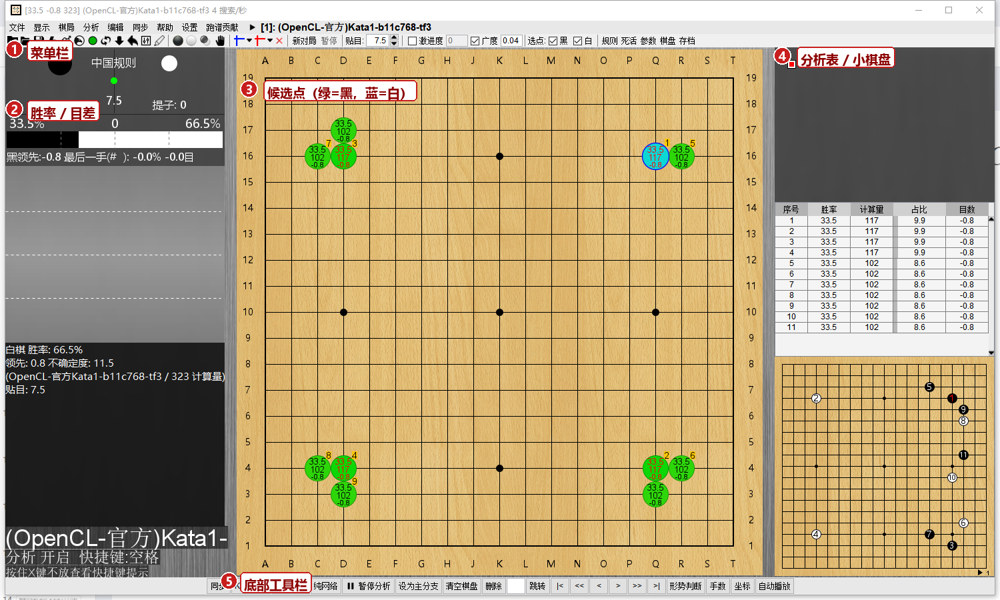
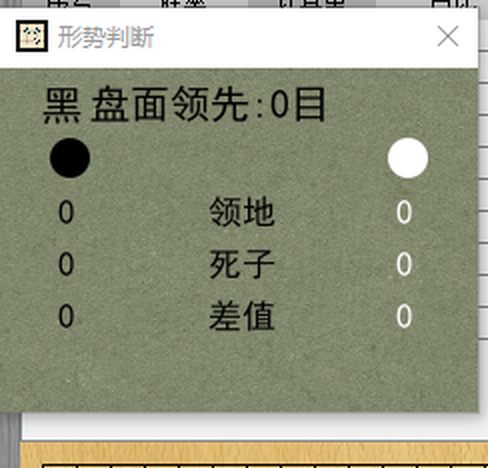
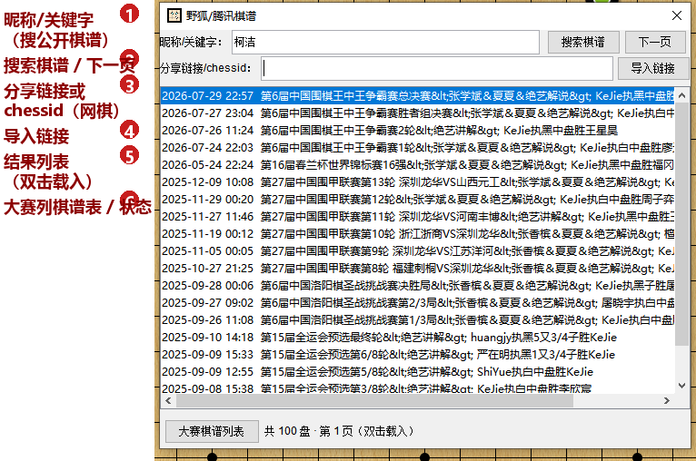
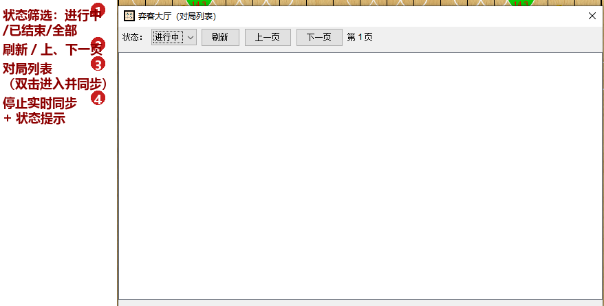

# LizzieYzy yzy2.5.4 使用说明

> 版本：**2.5.4**（子版本 20261026）
> 本说明对应 2026-10-26 重建的 Windows x64 整合包。
> 源码仓库：<https://github.com/KataMonk/lizzieyzy>（基于 <https://github.com/yzyray/lizzieyzy> 修改）

---

## 1. 这是什么

LizzieYzy 是围棋 AI 分析界面（Lizzie 的修改版），内置 KataGo 引擎与权重，可实时分析局面、
显示候选点与胜率、做形势判断（目数估计）、导入/分析棋谱，并支持野狐（腾讯围棋）棋谱与弈客直播/大厅。

本整合包特点：

- 自带 **JRE 17**，电脑无需安装 Java；
- 自带 **KataGo 1.18.1**（OpenCL 版）与两个权重（分析 + 形势判断各一个）；
- 已修复启动/字体/临时目录/黑屏等问题；
- 含「弈客直播」「弈客大厅」实时同步功能（大厅需自行配置 token，见 7.4）。

---

## 2. 快速开始

1. 解压整个文件夹到硬盘（**不要**直接在压缩包里运行）；
2. 双击 **`Lizzieyzy-2.5.4-win64.exe`** 启动；
3. 首次启动会自动生成运行文件并启动引擎，等待几秒即可看到棋盘。

启动方式（按优先级）：

| 情况 | 使用文件 |
|---|---|
| 正常 | `Lizzieyzy-2.5.4-win64.exe` |
| exe 打不开 / 闪退 | `bat启动器(exe无法打开时使用).bat` |
| 界面显示异常（黑屏、花屏） | `Lizzieyzy(仅在显示异常时尝试)-win64.exe` 或 `bat启动器(仅在显示异常时尝试).bat` |
| 想直接看报错 | 用 `bat启动器(...)` 启动，会保留控制台日志 |

> 如果杀毒软件拦截 exe，请把整个文件夹加入信任/白名单（exe 由 launch4j 封装，可能被误报）。

---

## 3. 目录结构

| 路径 | 作用 |
|---|---|
| `Lizzieyzy-2.5.4-win64.exe` | 主启动器（内含 jar） |
| `lizzie-yzy2.5.4-shaded.jar` | 程序本体（Java 8 目标字节码，可 `java -jar` 运行） |
| `jre\java17\` | 自带 Java 运行环境 |
| `weights\` | KataGo 权重（见第 4 节） |
| `katago_opencl\` | KataGo OpenCL 引擎（默认） |
| `katago_eigen\`、`katago_eigen_avx2\` | KataGo CPU 引擎（备用） |
| `katago_tensorRT\` | KataGo TensorRT 引擎（需要 NVIDIA + TensorRT 运行库，否则加载失败） |
| `katago_configs\` | 引擎配置：`analysis.cfg`（分析）、`estimate.cfg`（形势判断） |
| `KataGoData\` | 引擎缓存/临时数据（可删，程序会重建） |
| `theme\`、`sound\` | 棋盘主题与音效 |
| `temp\`、`persist`、`save\` | 运行期文件（可删；`save` 含自动保存棋谱时请注意备份） |
| `工具\` | 诊断脚本、日志启动器等 |
| `文档\` | 详细文档（分析、修复记录、抓包指南等） |
| `images\` | 本说明书使用的界面截图 |

---

## 4. 引擎与权重

本包只保留两个权重：

| 权重文件 | 用途 | 大小 |
|---|---|---|
| `kata1-tf3-b11c768-s12501M-d6467M.bin.gz` | **主分析引擎**（候选点/胜率） | 约 250 MB |
| `kata1-tf2-b10c384-s2941M-d5872M.bin.gz` | **形势判断**（目数估计，速度快） | 约 36 MB |

引擎条目（可在「设置 → 引擎设置」中切换，默认仍是 OpenCL）：

| 引擎条目 | 后端 | 说明 |
|---|---|---|
| `(OpenCL-官方)Kata1-b11c768-tf3` | OpenCL | **默认分析引擎**，兼容性最好 |
| `(OpenCL-官方)Kata1-b10c384-tf2` | OpenCL | 形势判断同款 |
| `(ONNX-DirectML)Kata1-b11c768-tf3` | ONNX + DirectML | 免 CUDA，Windows 10/11 自带 DirectML 即可（本机已实测可初始化） |
| `(ONNX-DirectML)Kata1-b10c384-tf2` | ONNX + DirectML | 同上 |
| `(CUDA-需CUDA12/cuDNN9)Kata1-…` | CUDA | 需要另装 **CUDA 12.1 + cuDNN 8.9.7** 运行库 |
| `(TensorRT10-需TRT10)Kata1-…` | TensorRT | 需要另装 **TensorRT 10.16.1 + CUDA 13.2** 运行库 |
| `(TensorRT8-自带库)Kata1-…` | TensorRT | 旧版 KataGo 1.13.1，DLL 已随包附带（`katago_tensorRT\`） |

> - 本包只带 ONNX 运行时（`katago_onnx\` 内含 onnxruntime/DirectML），
>   CUDA/TRT10 的 exe 已放入 `katago_cuda\`、`katago_tensorRT10\`，但**运行库需自行安装**；
> - 普通用户/无 NVIDIA 显卡：用 OpenCL 或 ONNX-DirectML 即可；
> - 配置里 `analysis-engine-command`（分析）与 `ui.estimate-command`（形势判断）仍指向 OpenCL 的
>   b11c768 / b10c384，切引擎不会影响形势判断。

---

## 5. 主界面图解

1. **菜单栏**：文件 / 显示 / 棋谱 / 分析 / 编辑 / 同步 / 帮助 / 设置；
2. **左侧面板**：当前胜率条与目差（如"黑领先 -0.8"即黑落后 0.8 目）、引擎计算量；
3. **棋盘候选点**：绿色=黑方选点，蓝色=白方选点；点上的数字为计算量占比，颜色深浅表示胜率变化；
4. **右侧面板**：分析表（序号/胜率/计算量/占比/目数）、变化图、小棋盘；
5. **底部工具栏**：开始/暂停分析、清空棋盘、跳转、形势判断、手数、坐标、自动播放等。

常用操作：

- **分析**：底部工具栏「开始分析 / 暂停分析」；
- **翻手**：底部工具栏 `<` `>`（上一手/下一手）、跳转按钮；
- **落子/试下**：鼠标点击棋盘；
- **打开/保存棋谱**：菜单「文件 → 打开 / 保存」；支持 SGF；
- **引擎设置**：菜单「设置 → 引擎设置」；
- **显示选项**：菜单「显示」里可调候选点数量、胜率、手数、坐标、主题等。

---

## 6. 形势判断（目数估计）

### 6.1 打开与参数

- 底部工具栏「形势判断」或菜单「分析 → 形势判断」；
- 设置对话框里可调：
  - **KataGo 阈值（低）**：默认 **0.2**
  - **高阈值**：默认 **0.5**

### 6.2 面板含义

| 显示项 | 含义 |
|---|---|
| 领地 | 空（只数空点，不含己方棋子） |
| 死子 | 己方区域内的**对方死子** |
| 差值 | 空 + 对方死子 + 提子 |
| **盘面领先** | **面积差** =（活子 + 空 + 对方死子）之差，不含贴目 |

> 盘面领先按"面积"计算，与"数目法"的盘面一致；例如引擎分数 −0.8、贴目 7.5 时，
> 面积差约为 7 目（黑盘面领先）。

### 6.3 注意

- 形势判断依赖 b10c384 引擎，未加载完引擎时结果可能为空或滞后；
- 大块死活、让子局、贴目异常时统计可能有偏差，可切换「数目/面积」显示或调阈值；
- 可在设置中关闭形势判断校准（`estimate-calibrate`），关闭后显示原始 KataGo ownership 估计。

---

## 7. 棋谱与在线对局

### 7.1 野狐 / 腾讯棋谱（菜单：同步 → 腾讯棋谱）

窗口分两部分：

1. **第一行「昵称/关键字」+ 搜索棋谱 + 下一页**
   - 输入昵称（如 `柯洁`）→ 搜索官网**公开/大赛棋谱**（每页 20 盘，状态栏显示"共 X 盘"）；
   - 双击任意一盘即可载入；「下一页」翻页；
   - ⚠️ 普通网棋（对局室下出来的棋）**不在**官网棋谱索引里，搜不到属正常，请用第二行导入。
2. **第二行「分享链接/chessid」+ 导入链接**
   - 粘贴分享链接，例如：
     `https://h5.foxwq.com/yehunewshare/?chessid=1784893976010001495&boardsize=19&...`
     或旧格式 `http://share.foxwq.com/index.html?...&chessid=...`；
   - 也可以只填 chessid（纯数字）；
   - 点「导入链接」（或回车）即可下载 SGF 并载入。
3. 底部「大赛棋谱列表」可快速载入官网最新大赛棋谱。

> 腾讯围棋与野狐同属腾讯，腾讯分享链接里的 chessid 同样可导入。

### 7.2 弈客直播（菜单：文件 → 打开在线链接）

支持链接格式：

- `https://home.yikeweiqi.com/#/live/new-room/197418/0/0`
- `https://home.yikeweiqi.com/#/live/room/18328/1/15630642`
- `https://home.yikeweiqi.com/#/live/board/<id>`

粘贴后点确定，程序会拉取当前局面 SGF，并按对话框里的「刷新时间」自动轮询更新。

### 7.3 弈客大厅（菜单：同步 → 弈客大厅）

- 打开对局列表（状态可选：进行中 / 已结束 / 全部），可翻页、刷新；
- **双击任意一局** → 载入当前局面，并自动进入**实时同步**（每 3 秒检测手数，对手落子自动跟着落子）；
- 对话框显示「实时同步中：黑 vs 白（N 手）」，点「停止同步」可退出；
- 也可把 `#/game/play/<hall>/<id>` 链接粘贴到「文件 → 打开在线链接」，同样会自动同步。

### 7.4 弈客 token 配置（大厅必需）

代码中**不包含任何 token**，需要你自己提供（一次配置长期可用）：

1. 打开任意弈客对局页 → 按 **F12** → **Network** →
   找 `game-server.yikeweiqi.com/game/info?id=...` 请求 →
   请求头 `authorization: Bearer xxxxx` → 复制 `Bearer` 后面的字符串；
2. 在程序目录新建 **`yike-token.txt`**，把 token 粘贴进去保存（UTF-8，单行）；
   或者在 `config.txt` 的 `ui` 里加 `"yike-game-token": "你的token"`；
   或启动参数加 `-Dlizzie.yike.token=你的token`。
3. 重新打开「弈客大厅」即可。

> token 过期/失效时大厅会提示无法加载，重新抓一个替换即可。

### 7.5 抓包

详细步骤见 `文档\抓包指南.md`。

---

## 8. 常用设置（config.txt）

| 配置项 | 说明 |
|---|---|
| `ui.estimate-threshold` / `ui.estimate-high-threshold` | 形势判断低/高阈值（默认 0.2 / 0.5） |
| `ui.estimate-calibrate` | 形势判断校准开关（默认 true） |
| `leelaz.max-analyze-time-seconds` | 单步分析时间上限（默认 0 = 不限制） |
| `leelaz.limit-time` / `leelaz.limit-playout` | 是否限制分析时间/计算量（默认 false） |
| `ui.read-komi` | 读谱时是否自动使用棋谱贴目 |
| `ui.always-gotolast-onlive` | 直播有新落子时是否自动跳到最后 |
| `ui.estimate-command` | 形势判断引擎命令（b10c384） |
| `ui.analysis-engine-command` | 分析引擎命令（b11c768） |

> ⚠️ 手工改 `config.txt` 时请保持 JSON 格式正确；若格式错误，程序会把旧文件改名为
> `config_wrong.txt` 并生成默认配置。

---

## 9. 常见问题

| 现象 | 处理 |
|---|---|
| 双击 exe 没反应/闪退 | 改用 `bat启动器(exe无法打开时使用).bat`（可看报错） |
| 界面黑屏/花屏 | 用 `Lizzieyzy(仅在显示异常时尝试)-win64.exe` |
| 提示 `Can't create cache file!` 或字体异常 | 本包已内置临时目录/字体回退；若仍出现，把 `temp` 文件夹删除后重启 |
| 引擎加载失败 | 检查 `weights\` 是否存在、`katago_opencl\katago.exe` 是否被杀毒拦截；TensorRT 条目需要 NVIDIA/TensorRT 环境，普通机器请选 OpenCL 条目 |
| 形势判断没有数字 | 等引擎就绪；检查是否打开了形势判断；调低阈值；确认 `estimate-command` 指向的权重存在 |
| 野狐昵称搜不到某盘棋 | 普通网棋不在官网索引，请用「分享链接/chessid」导入 |
| 弈客大厅提示未配置 token | 按 7.4 配置 `yike-token.txt` |
| 弈客直播/大厅拉不到数据 | 弈客接口可能变更/维护；把链接发到 issue，或参考抓包指南自行抓新接口 |
| 控制台出现 `Problem reading font data` | 本版已修复（自动改用可写临时文件加载字体）；若仍出现，删除 `temp\` 后重启 |
| 切到 CUDA/TensorRT10 引擎报错/闪退 | 缺少对应运行库（CUDA 12.1+cuDNN 8.9.7 / TensorRT 10.16.1+CUDA 13.2）；改回 OpenCL 或 ONNX-DirectML |
| 配置被改坏 | 删除 `config.txt`（或参考 `config_wrong.txt`）重启，程序会生成默认配置 |

---

## 10. 文档与反馈

`文档\` 目录内：

- `LizzieYzy-整合包与形势判断总结.md` —— 整合包结构、修复记录、形势判断原理与调参；
- `LizzieYzy-代码分析.md` —— 代码结构与功能分析；
- `KataGo-对比分析.md` —— KataGo 1.18 对比说明；
- `弈客直播-大厅-腾讯棋谱-野狐棋谱-修复方案.md` —— 在线功能接口与修复记录；
- `抓包指南.md` —— 弈客/野狐抓包方法。

反馈：<https://github.com/KataMonk/lizzieyzy/issues>

QQ 群（群文件下载）：584641555(四群)、246284327(三群)、867298807(二群)、786173361(一群)

---

## 11. 版本记录

- **2.5.4（20261026）**
  - 检查更新窗口精简：只显示版本号 + QQ 群下载提示；
  - 关于页：子版本 20261026，修改者 yzyray、katamonk，源代码指向新仓库；
  - 版本号 2.5.4（jar/exe/目录名同步）；
  - 重写使用说明（含界面截图）；
  - 修复坏 TEMP 环境下 Problem reading font data（字体改用文件方式兜底加载）；
  - 新增 ONNX-DirectML / CUDA12 / TensorRT10 引擎条目（默认仍 OpenCL）。
- **2.5.3 基础（2023-06 源码重建）**
  - 启动/字体/临时目录/黑屏修复；
  - 形势判断校准（领地/死子/差值/盘面领先=面积差）、阈值默认 0.2/0.5、取消单步分析上限；
  - 野狐/腾讯棋谱导入（昵称搜索、大赛列表、分享链接）；
  - 弈客直播（HTTP 轮询）、弈客大厅（列表 + 实时同步，需 token）；
  - 内存/CPU/重绘性能优化；移除内置 token 等私密信息。
